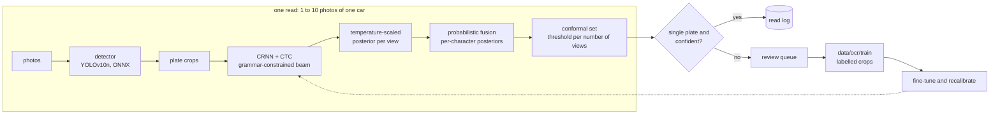
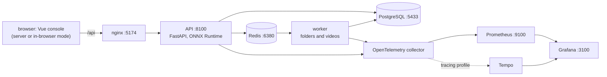

# DetectionX5: a Moroccan licence-plate reading platform

DetectionX5 reads Moroccan licence plates from photos. It finds the plate in each photo,
reads it with a recogniser that can only produce strings the plate grammar allows, fuses
several photos of the same car into one read, reports a calibrated confidence and a
conformal prediction set, and sends the reads it cannot certify to a human review queue
whose corrections become training data. A Vue console shows every step, and can run both
models in the browser so that a photo never leaves the device. Everything runs locally: no
API key, no network call at inference time.

The models are trained and calibrated on deterministic synthetic plates. A private set of
street photos of vehicles, held out from every training set, with plate text transcribed by
eye, measures them: the recogniser from the labelled boxes, the whole pipeline end to end,
and the detector on the same photos. Every synthetic number says so: synthetic results are
not real-world accuracy.

<!-- BEGIN RENDER ocr-benchmark-status -->
[OCR accuracy is benchmarked on 258 street photos of vehicles, held out from every training set](#real-photos), with 219 readable plates labelled. The best recogniser, the CRNN with the constrained beam, reads 11% (6 to 16) of those plates exactly from their labelled boxes and 14% (9 to 20) of the photos end to end with the shipped detector. The detector is not independent of these photos: every camera photo behind this split also has copies in the split the detector was trained on. The confidence and the conformal sets are still calibrated on synthetic plates.
<!-- END RENDER ocr-benchmark-status -->

```console
$ uv run plate read samples/car.jpg
$ just demo        # the whole stack in Compose; prints where the console is
```

## Contents

- [Why it is built this way](#why-it-is-built-this-way)
- [Architecture](#architecture)
- [How a read works](#how-a-read-works)
- [Results](#results)
- [Development and synthetic harness](#development-and-synthetic-harness)
- [Run it](#run-it)
- [Insert your own data](#insert-your-own-data)
- [What changes once real data arrives](#what-changes-once-real-data-arrives)
- [Honesty and limitations](#honesty-and-limitations)
- [The original reader](#the-original-reader)
- [Development](#development)
- [Credits and licence](#credits-and-licence)

## Why it is built this way

- **Plates have a grammar, so the reader should know it.** A standard plate is one to five
  digits, one of six Arabic letters and a one- or two-digit region; a temporary plate is
  digits followed by `WW`. The formats are compiled into one minimal automaton
  ([`plate_reader/grammar.py`](plate_reader/grammar.py)), and the recogniser's beam search
  only extends prefixes the automaton accepts, so it cannot return an impossible plate.
- **A confidence is only useful if it is calibrated.** The CRNN's posterior over plates is
  temperature-scaled on a held-out split, and every read carries a split-conformal
  prediction set: the plates that cannot be ruled out at the stated level. A set with more
  than one plate, or an empty one, is the system saying it does not know, and the read goes
  to review instead of being trusted.
- **Several photos beat one.** Views are fused in probability space (the product of the
  per-view posteriors is Bayes' rule for independent views), each number of fused views has
  its own conformal threshold, and every character of the fused read gets its own
  posterior.
- **No real data is no excuse for no measurement.** A seeded generator renders plates with
  open-licensed fonts and documented degradations; every split has its own seed; every
  metric has a bootstrap interval; a heavier pseudo-real preset stands in for the
  sim-to-real gap; and `data/` is a documented placeholder with a validator, ready for real
  photos.
- **Two runtimes, one answer.** The browser runtime is a TypeScript port of the Python
  pipeline's image operations, decoders and fusion; CI fails when it disagrees with the
  Python pipeline on the committed fixtures.

## Architecture





The packages: [`plate_reader`](plate_reader) (grammar, synthetic generator, evaluation
harness, CRNN, calibration and conformal sets, fusion, pipeline, training, the `plate`
command line), [`services/api`](services/api) (the service, its database, jobs and review
queue) and [`apps/dashboard`](apps/dashboard) (the console and the in-browser runtime).
Decisions are recorded as ADRs in [`docs/adr`](docs/adr).

## How a read works

1. **Detect.** The YOLOv10n detector (ONNX, the NMS-free one-to-one head) finds plate boxes
   in each letterboxed photo; boxes are padded, cropped and de-duplicated, and each photo
   contributes its most confident plate.
2. **Read.** The CRNN (a residual CNN, a bidirectional LSTM and CTC) turns the grey crop into
   per-frame class scores; a prefix beam search that carries the grammar automaton's state
   keeps only viable plate prefixes and returns grammar-valid strings with their summed
   alignment probabilities.
3. **Calibrate.** One temperature, fitted by golden-section search on the negative
   log-likelihood of the true plate under the reported posterior, turns the beam into a
   calibrated distribution over plates.
4. **Fuse.** Every view's distribution is renormalised over the union of candidates with a
   floor and the views are multiplied (log opinion pooling), with exactly rounded sums so the
   order of the photos never matters; each character of the winner gets a posterior from
   aligning every candidate to it.
5. **Certify.** The conformal set keeps every candidate whose nonconformity (the probability
   mass of the other candidates) is under the threshold calibrated for that number of
   proposing views. The service serves sets at the level `PLATE_ALPHA` sets.
6. **Review.** A read whose set is not a single plate, or whose confidence is under
   `PLATE_REVIEW_THRESHOLD`, joins the review queue; a confirmed or corrected read exports
   its crops and label in the `data/ocr/train` layout, which `plate train crnn` fine-tunes on.

The equations, their assumptions and their tests are in
[`docs/methods/fusion.md`](docs/methods/fusion.md) and the
[model card](docs/model_card.md); the console's Methods page typesets them.

## Results

Every number in this section and the next is rendered by `uv run plate docs render` from
[`docs/training_results.csv`](docs/training_results.csv) and `results/*.json`;
`uv run plate docs check` fails if a number is edited by hand or drifts from its source.

### Real photos

Street photos of vehicles, held out from every training set, read from their labelled boxes
and end to end the way the service reads them, rendered from `results/eval_data.json`,
`results/eval_data_e2e.json` and `results/eval_detector_data.json`. The photos and their
labels stay private and out of git; how the set was built and transcribed is in the
[data card](docs/data_card.md), and why its intervals resample vehicles is
[ADR 0013](docs/adr/0013-real-benchmark-grouped-bootstrap.md).

<!-- BEGIN RENDER real-photos -->
Set: data (`data/eval/labels.csv`, private and not in the repository): street photos of vehicles, held out from every training set as files, with every box checked by eye and every plate transcribed twice and checked against the plate grammar, n = 258 photos holding 261 labelled plates. Every photo is an augmented copy of one of 196 camera photos (32 contrast changed, 51 noise added, 43 shifted, 41 rotated, 47 mirrored and 44 upside down); the mirrored and upside-down copies were flipped back exactly, so every plate reads the right way round. Every camera photo behind this split also has copies in the split the detector was trained on: the detector has seen these scenes, so the end-to-end and detector figures below are not independent of its training data; the recogniser has only ever seen synthetic plates.

The plate text was transcribed by eye, crop by crop: every plate crop was read twice on differently ordered contact sheets, every string was checked against the plate grammar, and every disagreement, invalid or doubtful reading was read a third time at a higher zoom. The two passes agreed on 255 of 260 crops, and on all 224 where both gave a reading the grammar accepts; the third pass accepted 26 of the 67 crops it saw. 219 plates in 218 photos are labelled (133 distinct vehicles); 42 were left out: 27 illegible in the photo, 12 outside the grammar and 3 with no plate in the box. The benchmark therefore measures plates a person can read, and does not count the ones left out as failures.

Values with 95% bootstrap intervals that resample the 132 vehicle groups (a vehicle with every photo it appears in) instead of single photos, since copies of one photo and repeat photos of one vehicle are not independent (1000 resamples).

Read from the labelled box, padded exactly as the service pads a detection (n = 219 plates in 218 photos):

| Recogniser | Version | Exact match | Digits | Letter | Region | Character error rate |
|---|---|---|---|---|---|---|
| CRNN, greedy | `crnn-5348143705d4-T0.888664` | 8% (4 to 13) | 16% (10 to 22) | 21% (14 to 27) | 14% (8 to 20) | 54% (48 to 59) |
| CRNN, constrained beam | `crnn-5348143705d4-T0.888664` | 11% (6 to 16) | 23% (16 to 30) | 48% (40 to 57) | 34% (26 to 42) | 53% (47 to 58) |

Letter and region are scored on the 202 standard plates; a temporary plate has neither. A lower character error rate is better.

Read end to end with the shipped detector, the labelled boxes ignored: the most confident detection of each photo is cropped exactly as the service crops it (n = 218 photos). Every photo had a detection; in two the most confident detection was not on the labelled plate, which counts as a wrong read. The most confident detection lay on the labelled plate in 99% (98 to 100) of the photos.

| Recogniser | Version | Exact match | Digits | Letter | Region | Character error rate |
|---|---|---|---|---|---|---|
| CRNN, greedy | `crnn-5348143705d4-T0.888664` | 11% (6 to 17) | 15% (9 to 21) | 21% (15 to 28) | 15% (9 to 21) | 52% (47 to 58) |
| CRNN, constrained beam | `crnn-5348143705d4-T0.888664` | 14% (9 to 20) | 25% (19 to 32) | 47% (38 to 56) | 34% (26 to 41) | 53% (48 to 58) |

Letter and region are scored on the 201 photos whose plate is a standard one; a temporary plate has neither. A lower character error rate is better.

Exact match side by side:

| Recogniser | From the labelled box (n = 219 plates) | End to end (n = 218 photos) |
|---|---|---|
| CRNN, greedy | 8% (4 to 13) | 11% (6 to 17) |
| CRNN, constrained beam | 11% (6 to 16) | 14% (9 to 20) |

The detector, measured on every valid box of the held-out street photos, the plates whose text was left out included, and the photo whose only box is degenerate left out: `models/best.pt` at image size 640, one Ultralytics validation pass, so no interval. This column is not an independent measurement of the detector: every camera photo behind this split also has copies in the split the detector was trained on.

| Metric | Street photos (n = 257 photos, 260 plates) | Synthetic street scenes (n = 150 scenes) |
|---|---|---|
| Precision | 0.993 | 0.729 |
| Recall | 0.988 | 0.948 |
| mAP@50 | 0.995 | 0.843 |
| mAP@50-95 | 0.792 | 0.602 |

Synthetic results are not real-world accuracy: the synthetic column comes from procedural street scenes.

The calibration remains synthetic. Neither the temperature nor any conformal threshold was refitted on these photos, which are the reporting set: the constrained beam's confidence, temperature-scaled on synthetic plates, has an expected calibration error of 40% (35 to 44) on these plates, and its conformal sets, whose thresholds were fitted on synthetic splits, hold the true plate for 0% (0 to 0) of them. A separate real calibration split comes next; until then neither the confidence nor a set is to be trusted on real photos.

The sim-to-real gap: exact match of the same recognisers on the synthetic test set and on the labelled plates. Synthetic results are not real-world accuracy; the synthetic column is the development harness's, shown only to measure the gap.

| Recogniser | Synthetic test set (n = 300) | Real plates (n = 219) | Gap |
|---|---|---|---|
| CRNN, greedy | 99% (98 to 100) | 8% (4 to 13) | 91 points lower on real photos |
| CRNN, constrained beam | 99% (98 to 100) | 11% (6 to 16) | 88 points lower on real photos |

Reproduce (with the photos in place): `uv run plate eval --set data -r crnn-greedy -r crnn-beam --views 0 --note "street photos of vehicles, held out from every training set as files, with every box checked by eye and every plate transcribed twice and checked against the plate grammar"`, the same with `--detect`, and `uv run plate eval-detector --data data/eval/detector.yaml --note "every valid box of the held-out street photos, the plates whose text was left out included, and the photo whose only box is degenerate left out"`.
<!-- END RENDER real-photos -->

### Detection model

<!-- BEGIN RENDER detector-metrics -->
`models/best.pt` (version `648b737411ad`): YOLOv10n fine-tuned for 100 epochs on a single `LP` class, trained on a plate dataset plus photos from the firm's experts. The shipped checkpoint is epoch 90, the epoch Ultralytics selected by its fitness score (0.1 x mAP@50 + 0.9 x mAP@50-95). Values are from that epoch's row of the training log.

| Metric | Value |
|---|---|
| Precision | 0.956 |
| Recall | 0.945 |
| mAP@50 | 0.983 |
| mAP@50-95 | 0.744 |

Set: the detector's own validation split (data). The training log does not record the split size, and a single validation pass gives no confidence interval, so neither n nor a CI is reported for these four numbers.
<!-- END RENDER detector-metrics -->

Full per-epoch metrics are in [`docs/training_results.csv`](docs/training_results.csv).
These figures are not independent of the detector's training either: its validation split
holds other augmented copies of the camera photos in its training split, the same overlap
the real photos above carry.

## Development and synthetic harness

The figures the models are developed, trained and calibrated against: deterministic
synthetic plates and scenes, every split with its own seed, every metric with a bootstrap
interval. Synthetic results are not real-world accuracy; they say how the models behave on the
generator's distribution, and the real photos above say how far that is from the street.

### The detector on synthetic street scenes

Rendered from `results/eval_detector_synthetic.json`:

<!-- BEGIN RENDER detector-synthetic -->
**Synthetic results are not real-world accuracy.** `models/best.pt` on the `val` split of a synthetic street-scene set: 150 scenes holding 135 plates (15 with no plate), generator seed 1005, version 1, image size 640. One Ultralytics validation pass, so no interval; procedural scenes say nothing about real photos.

| Metric | Value |
|---|---|
| Precision | 0.729 |
| Recall | 0.948 |
| mAP@50 | 0.843 |
| mAP@50-95 | 0.602 |

Precision is below recall by 0.219: on these scenes the detector proposes boxes that are not plates more often than it misses a plate. The gap is noted and not acted on: the detector is not fine-tuned on synthetic scenes, and only a labelled set of real photos can say whether it matters.

Reproduce: `uv run plate synth scenes --n 300 --seed 1005 --val-fraction 0.5 --out synthetic/scenes-eval` then `uv run plate eval-detector --data synthetic/scenes-eval/detector.yaml`.
<!-- END RENDER detector-synthetic -->

### Recognisers on synthetic plates

<!-- BEGIN RENDER synthetic-baseline -->
**Synthetic results are not real-world accuracy.** Set: synthetic (`synthetic`), n = 300, generator seed 1005; values with 95% bootstrap intervals over images (1000 resamples).

| Recogniser | Version | Exact match | Digits | Letter | Region | CER | ECE | Set coverage |
|---|---|---|---|---|---|---|---|---|
| easyocr | `easyocr-1.7.2+segmentation` | 0.353 [0.297, 0.407] | 0.417 [0.357, 0.473] | 0.639 [0.581, 0.696] | 0.522 [0.460, 0.585] | 0.579 [0.525, 0.639] | 0.192 [0.151, 0.235] | n/a |
| crnn-greedy | `crnn-5348143705d4-T0.888664` | 0.990 [0.980, 1.000] | 0.993 [0.983, 1.000] | 0.996 [0.987, 1.000] | 0.996 [0.986, 1.000] | 0.002 [0.000, 0.006] | 0.288 [0.264, 0.310] | n/a |
| crnn-beam | `crnn-5348143705d4-T0.888664` | 0.990 [0.980, 1.000] | 0.993 [0.983, 1.000] | 0.996 [0.987, 1.000] | 0.996 [0.986, 1.000] | 0.002 [0.000, 0.006] | 0.009 [0.002, 0.017] | 0.900 [0.867, 0.933] |
| crnn-beam-unconstrained | `crnn-5348143705d4-T0.888664` | 0.990 [0.980, 1.000] | 0.993 [0.983, 1.000] | 0.996 [0.987, 1.000] | 0.996 [0.986, 1.000] | 0.002 [0.000, 0.006] | 0.009 [0.003, 0.018] | n/a |

Set coverage is the share of truths inside the conformal set at the level fixed on the synthetic conformal split; it holds its level only when the evaluated images are exchangeable with that split, so a drop on the pseudo-real set is the expected warning sign of a distribution shift, not a bug.

Multi-view sets (exact match of the fused read; n = 100 sets, bootstrap over sets):

| Recogniser | Fusion | 1 view(s) | 3 view(s) | 5 view(s) |
|---|---|---|---|---|
| easyocr | legacy_vote | 0.380 [0.290, 0.470] | 0.650 [0.550, 0.740] | 0.650 [0.550, 0.740] |
| easyocr | probabilistic | 0.380 [0.290, 0.470] | 0.580 [0.480, 0.670] | 0.620 [0.530, 0.720] |
| easyocr | probabilistic_weighted | 0.380 [0.290, 0.470] | 0.600 [0.500, 0.690] | 0.640 [0.540, 0.730] |
| crnn-greedy | legacy_vote | 0.980 [0.950, 1.000] | 1.000 [1.000, 1.000] | 1.000 [1.000, 1.000] |
| crnn-greedy | probabilistic | 0.980 [0.950, 1.000] | 1.000 [1.000, 1.000] | 1.000 [1.000, 1.000] |
| crnn-greedy | probabilistic_weighted | 0.980 [0.950, 1.000] | 1.000 [1.000, 1.000] | 1.000 [1.000, 1.000] |
| crnn-beam | legacy_vote | 0.980 [0.950, 1.000] | 1.000 [1.000, 1.000] | 1.000 [1.000, 1.000] |
| crnn-beam | probabilistic | 0.980 [0.950, 1.000] | 1.000 [1.000, 1.000] | 1.000 [1.000, 1.000] |
| crnn-beam | probabilistic_weighted | 0.980 [0.950, 1.000] | 1.000 [1.000, 1.000] | 1.000 [1.000, 1.000] |
| crnn-beam-unconstrained | legacy_vote | 0.980 [0.950, 1.000] | 1.000 [1.000, 1.000] | 1.000 [1.000, 1.000] |
| crnn-beam-unconstrained | probabilistic | 0.980 [0.950, 1.000] | 1.000 [1.000, 1.000] | 1.000 [1.000, 1.000] |
| crnn-beam-unconstrained | probabilistic_weighted | 0.980 [0.950, 1.000] | 1.000 [1.000, 1.000] | 1.000 [1.000, 1.000] |
<!-- END RENDER synthetic-baseline -->

### The CRNN: training and calibration

<!-- BEGIN RENDER crnn-training -->
`models/crnn.onnx` (version `5348143705d4`, 5.8 MB, 1440051 parameters): trained on synthetic crops only, 24 epochs of 20000 freshly generated crops each on `cuda`, in 1139.4 s. The kept epoch is 18, chosen by greedy exact match on the synthetic validation split (0.995). Fine-tuned on real data: no. Augmentation: the generator's default degradation bounds. Synthetic results are not real-world accuracy.
<!-- END RENDER crnn-training -->

<!-- BEGIN RENDER crnn-calibration -->
**Synthetic results are not real-world accuracy.** Model `5348143705d4`; temperature fitted on the synthetic calibration split (n = 2000): T = 0.889, NLL of the true plate 0.040 at T = 1 and 0.040 after.

| Split | Exact match | Mean confidence | ECE |
|---|---|---|---|
| calibration, T = 1 | 0.995 [0.992, 0.998] | 0.995 [0.993, 0.996] | 0.004 [0.002, 0.006] |
| calibration, fitted T | 0.995 [0.992, 0.998] | 0.996 [0.994, 0.997] | 0.002 [0.002, 0.006] |
| test, fitted T | 0.995 [0.991, 0.998] | 0.997 [0.995, 0.998] | 0.004 [0.002, 0.007] |

Conformal prediction sets (thresholds from the conformal split, n = 2000; coverage measured on the test split, n = 2000, with a joint bootstrap over both splits):

| Level | Coverage | Mean set size | Singleton sets |
|---|---|---|---|
| 90% | 0.901 [0.882, 0.918] | 0.901 [0.882, 0.918] | 0.901 |
| 95% | 0.955 [0.935, 0.965] | 0.955 [0.935, 0.965] | 0.955 |
<!-- END RENDER crnn-calibration -->

### Multi-view fusion

Rendered from `results/eval_views.json`; the method and its properties are in
[`docs/methods/fusion.md`](docs/methods/fusion.md).

<!-- BEGIN RENDER fusion-comparison -->
**Synthetic results are not real-world accuracy.** Multi-view synthetic sets: n = 200 plates with up to 5 views each (generator seed 1007); the first k views of every set are fused; values with bootstrap intervals over sets.

Multi-view sets (exact match of the fused read; n = 200 sets, bootstrap over sets):

| Recogniser | Fusion | 1 view(s) | 3 view(s) | 5 view(s) |
|---|---|---|---|---|
| easyocr | legacy_vote | 0.295 [0.235, 0.360] | 0.545 [0.475, 0.615] | 0.585 [0.515, 0.650] |
| easyocr | probabilistic | 0.295 [0.235, 0.360] | 0.465 [0.395, 0.530] | 0.520 [0.445, 0.590] |
| easyocr | probabilistic_weighted | 0.295 [0.235, 0.360] | 0.475 [0.405, 0.540] | 0.520 [0.445, 0.585] |
| crnn-greedy | legacy_vote | 0.990 [0.975, 1.000] | 1.000 [1.000, 1.000] | 1.000 [1.000, 1.000] |
| crnn-greedy | probabilistic | 0.990 [0.975, 1.000] | 1.000 [1.000, 1.000] | 1.000 [1.000, 1.000] |
| crnn-greedy | probabilistic_weighted | 0.990 [0.975, 1.000] | 1.000 [1.000, 1.000] | 1.000 [1.000, 1.000] |
| crnn-beam | legacy_vote | 0.990 [0.975, 1.000] | 1.000 [1.000, 1.000] | 1.000 [1.000, 1.000] |
| crnn-beam | probabilistic | 0.990 [0.975, 1.000] | 1.000 [1.000, 1.000] | 1.000 [1.000, 1.000] |
| crnn-beam | probabilistic_weighted | 0.990 [0.975, 1.000] | 1.000 [1.000, 1.000] | 1.000 [1.000, 1.000] |

Calibration and conformal sets of the fused read (each number of views has its own threshold, fitted on separate synthetic multi-view sets; see `results/calibration_fused.json`):

| Recogniser | Fusion | Views | ECE | Set coverage | Mean set size |
|---|---|---|---|---|---|
| easyocr | legacy_vote | 1 | 0.166 [0.120, 0.217] | n/a | n/a |
| easyocr | legacy_vote | 5 | 0.102 [0.072, 0.153] | n/a | n/a |
| easyocr | probabilistic | 1 | 0.166 [0.120, 0.217] | n/a | n/a |
| easyocr | probabilistic | 5 | 0.187 [0.139, 0.242] | n/a | n/a |
| easyocr | probabilistic_weighted | 1 | 0.160 [0.116, 0.211] | n/a | n/a |
| easyocr | probabilistic_weighted | 5 | 0.202 [0.153, 0.259] | n/a | n/a |
| crnn-greedy | legacy_vote | 1 | 0.010 [0.000, 0.025] | n/a | n/a |
| crnn-greedy | legacy_vote | 5 | 0.003 [0.001, 0.006] | n/a | n/a |
| crnn-greedy | probabilistic | 1 | 0.010 [0.000, 0.025] | n/a | n/a |
| crnn-greedy | probabilistic | 5 | 0.000 [0.000, 0.000] | n/a | n/a |
| crnn-greedy | probabilistic_weighted | 1 | 0.010 [0.000, 0.025] | n/a | n/a |
| crnn-greedy | probabilistic_weighted | 5 | 0.000 [0.000, 0.000] | n/a | n/a |
| crnn-beam | legacy_vote | 1 | 0.010 [0.000, 0.025] | n/a | n/a |
| crnn-beam | legacy_vote | 5 | 0.004 [0.001, 0.007] | n/a | n/a |
| crnn-beam | probabilistic | 1 | 0.010 [0.003, 0.018] | 0.930 [0.895, 0.960] | 0.930 [0.895, 0.960] |
| crnn-beam | probabilistic | 5 | 0.000 [0.000, 0.000] | 0.900 [0.855, 0.940] | 0.900 [0.855, 0.940] |
| crnn-beam | probabilistic_weighted | 1 | 0.033 [0.024, 0.051] | 0.335 [0.270, 0.400] | 0.335 [0.270, 0.400] |
| crnn-beam | probabilistic_weighted | 5 | 0.000 [0.000, 0.000] | 0.250 [0.190, 0.305] | 0.250 [0.190, 0.305] |
<!-- END RENDER fusion-comparison -->

### The pseudo-real stand-in

A heavier augmentation preset stands in for the gap between synthetic and real photos until
real labelled data exists. Rendered from `results/eval_pseudo_real.json`. The console's
Models page draws the gap per recogniser, and `plate sweep` searches the augmentation
strengths that narrow it; its best configuration was then trained in full and compared
with the shipped weights (both in the [model card](docs/model_card.md)).

<!-- BEGIN RENDER pseudo-real-baseline -->
**Synthetic results are not real-world accuracy.** Set: pseudo_real (`pseudo_real`), n = 300, generator seed 1006; values with 95% bootstrap intervals over images (1000 resamples).

| Recogniser | Version | Exact match | Digits | Letter | Region | CER | ECE | Set coverage |
|---|---|---|---|---|---|---|---|---|
| easyocr | `easyocr-1.7.2+segmentation` | 0.023 [0.007, 0.043] | 0.030 [0.013, 0.050] | 0.135 [0.095, 0.181] | 0.021 [0.004, 0.041] | 0.951 [0.930, 0.969] | 0.153 [0.117, 0.193] | n/a |
| crnn-greedy | `crnn-5348143705d4-T0.888664` | 0.600 [0.540, 0.650] | 0.693 [0.640, 0.743] | 0.810 [0.758, 0.861] | 0.696 [0.637, 0.752] | 0.167 [0.138, 0.200] | 0.173 [0.138, 0.216] | n/a |
| crnn-beam | `crnn-5348143705d4-T0.888664` | 0.610 [0.553, 0.660] | 0.717 [0.667, 0.767] | 0.865 [0.823, 0.908] | 0.751 [0.693, 0.804] | 0.164 [0.135, 0.197] | 0.172 [0.135, 0.209] | 0.237 [0.187, 0.283] |
| crnn-beam-unconstrained | `crnn-5348143705d4-T0.888664` | 0.603 [0.543, 0.653] | 0.697 [0.640, 0.747] | 0.827 [0.777, 0.875] | 0.705 [0.646, 0.759] | 0.165 [0.136, 0.197] | 0.151 [0.118, 0.188] | n/a |

Set coverage is the share of truths inside the conformal set at the level fixed on the synthetic conformal split; it holds its level only when the evaluated images are exchangeable with that split, so a drop on the pseudo-real set is the expected warning sign of a distribution shift, not a bug.
<!-- END RENDER pseudo-real-baseline -->

## Run it

Python 3.12 managed by [uv](https://docs.astral.sh/uv/), Node 20 or newer for the console,
Docker for the stack, and [just](https://github.com/casey/just) for the recipes. On Windows
the lock installs a CUDA 12.6 build of PyTorch, on Linux a CPU build; the service and the
worker are torch-free (ONNX Runtime).

```bash
git clone https://github.com/storm2121/Detectionx5.git
cd Detectionx5
just setup             # .venv with every dependency group, git hooks
just demo              # docker compose up, then prints where the console is
```

`docker compose up --build -d` starts the API, the worker, Redis, PostgreSQL, the
OpenTelemetry collector, Prometheus, Grafana and the console;
`docker compose --profile tracing up --build -d` adds Tempo as the trace store. Host ports
are chosen so the stack does not clash with other projects on the same machine:

| Service | Host port |
|---|---|
| Console (nginx forwards `/api` to the API) | 5174 |
| API (`services.api.main:app`) | 8100 |
| PostgreSQL | 5433 |
| Redis | 6380 |
| Prometheus | 9100 |
| Grafana (dashboard "DetectionX5 plate service") | 3100 |
| OpenTelemetry collector | 4319 (gRPC), 4320 (HTTP) |

Without Docker, `just api` serves the API on port 8100 with SQLite under `storage/`,
`just worker` runs a job worker against Redis on port 6380, and `just dashboard` serves the
console with Vite on port 5174.

**The console** (http://localhost:5174): Read (drop one to ten photos of one car; boxes,
fields, calibrated confidence, conformal set, per-view hypotheses, the fusion table, the
character heatmap; server or in-browser mode with a parity indicator), Jobs
(folders and videos with live progress), Review queue (confirm, correct, export),
Evaluation (the labelled real photos first, from the box and end to end side by side with
the detector beside its synthetic scenes, then the synthetic harness: metrics with
intervals, reliability diagrams, letter confusions, fusion by number of views, coverage),
Models (the sim-to-real gap first, then the active models, thresholds, the registry, the
training curve and the augmentation sweep), Methods (the equations) and Browser parity. Light and dark themes, phone width, axe-checked; screenshots of every page in both
themes are in [`docs/images`](docs/images), and the design's departures from its brief in
[`docs/DESIGN_NOTES.md`](docs/DESIGN_NOTES.md).

**The service:**

| Endpoint | Purpose |
|---|---|
| `POST /read` | one to ten photos of one car: plate, fields, calibrated confidence, conformal set, per-view hypotheses, per-character posteriors, model version; `detect=false` reads photos as crops |
| `GET /reads`, `GET /reads/{id}` | the read log |
| `GET /review/queue`, `POST /review/{id}`, `POST /review/export` | reads to review; corrections export to `data/ocr/train` |
| `POST /jobs`, `POST /jobs/upload`, `GET /jobs`, `GET /jobs/{id}`, `GET /jobs/{id}/events` | folders and videos in the background (RQ on Redis), IoU tracking and per-track fusion, progress as Server-Sent Events |
| `GET /results`, `GET /results/{name}` | the committed evaluation results the console renders |
| `GET /models`, `GET /health`, `GET /metrics` | the registry and the loaded models, health, Prometheus metrics |

**The command line** (`uv run plate --help`):

| Command | What it does |
|---|---|
| `plate read PHOTO...` | read photos with the original reader (EasyOCR) |
| `plate synth crops / views / scenes / pseudo-real` | write deterministic synthetic sets |
| `plate eval --set synthetic / pseudo_real / views / data [--detect]` | evaluate recognisers with bootstrap intervals; `--detect` reads labelled photos end to end |
| `plate eval-detector --data DETECTOR_YAML` | detector precision, recall and mAP through Ultralytics validation |
| `plate train crnn / calibrate / calibrate-fused / detector` | train and calibrate |
| `plate export onnx / detector / fixtures / web` | export models, parity fixtures and the browser's assets |
| `plate sweep` | search augmentation strengths against the pseudo-real set |
| `plate compare-crnn --old A.onnx --new B.onnx` | two CRNNs on the same crops, paired, with the adoption rule |
| `plate registry promote / list` | the model registry |
| `plate data validate / init` | check or create the real-data layout |
| `plate docs render / check` | render and check every documented number |

## Insert your own data

Real photos and labels go under `data/` in a fixed layout (detector images and YOLO
labels; OCR crops with a `crop_path,plate_text,format` CSV), and `uv run plate data
validate` checks it before anything trains. The step-by-step guide is
[`docs/insert_your_own_data.md`](docs/insert_your_own_data.md); the data card
([`docs/data_card.md`](docs/data_card.md)) lists what the data encodes. Real photos stay out
of git: a pre-commit check refuses images, videos and large CSVs under `data/`.

## What changes once real data arrives

- `uv run plate eval --set data` measures every recogniser on the labelled plates in
  `data/eval` from their boxes, `--detect` reads the same photos end to end with the shipped
  detector, and `plate eval-detector --data data/eval/detector.yaml` measures the detector
  on them. This has happened on a private set of held-out street photos
  ([Real photos](#real-photos)); photos the detector has never seen in any form are the
  next step for an independent detector figure.
- `plate train crnn` fine-tunes the CRNN on `data/ocr/train`, and the review queue's exports
  keep adding to that split.
- The temperature and every conformal threshold (one view, and each number of fused views)
  are refitted on real calibration splits: thresholds hold only for images exchangeable
  with the split they were fitted on. This has not happened: the calibration remains
  synthetic, the real photos above are the reporting set and must not be used for it, and a
  separate real calibration split comes next.
- The detector is measured on real photos (`plate eval-detector`) and, if need be,
  fine-tuned (`plate train detector`); its real-photo figures so far come from photos whose
  scenes it was trained on, and its only independent ones from synthetic scenes.
- The augmentation sweep's objective moves from the pseudo-real tuning split to a real
  validation split, and the pseudo-real set becomes a robustness check instead of the
  stand-in for the real world.

## Honesty and limitations

- The real benchmark is one private set of street photos ([Real photos](#real-photos)).
  Every photo in it is an augmented copy of a camera photo (contrast, noise, a shift, a
  rotation or a flip, the flips undone), several photos show the same vehicle, and the
  intervals resample vehicles rather than photos for that reason. Plates nobody can read and
  plates outside the grammar are left out of it, so it measures plates a person can read.
- The detector has seen these scenes: every camera photo behind the set also has copies in
  the split the detector was trained on, and its own validation split shares camera photos
  with its training split in the same way. Neither its real-photo figures nor the end-to-end
  ones are an independent measurement of the detector, and none of its figures has an
  interval; its only independent figures come from procedural street scenes. The recogniser
  figures are clean: the recogniser has only ever seen synthetic plates.
- Every confidence and every conformal threshold is still fitted on synthetic data, and
  synthetic results are not real-world accuracy: on the real photos the calibrated confidence
  and the conformal sets do not hold (both are rendered with the real results). The
  calibration remains synthetic until a separate real calibration split is labelled. The
  pseudo-real set is synthetic too.
- The fonts approximate plate lettering; backgrounds are procedural; the generator draws no
  country band, dealer or damaged plates.
- Temporary plates are assumed to carry one to six digits until the range is confirmed.
- A conformal guarantee holds under exchangeability only; on images unlike the calibration
  split (the pseudo-real set shows how unlike) coverage drops, which is the warning it is
  meant to give.
- Only the six letters `أ ب د ه و ط` are accepted; other series are rejected by design.
- The original EasyOCR reader stays as the baseline and for the legacy entry points; it is
  much weaker than the CRNN on every synthetic set.

## The original reader

The project started as an EasyOCR reader: it finds the plate's two separator bars (the only
tall, very narrow marks on the plate), cuts the plate into its three fields, and reads each
field with the EasyOCR model suited to it, because reading the whole plate as one line turns
the bars into characters. That path is kept, behind the same shims as before:

```bash
python cli.py samples/car.jpg                 # read one image
python cli.py front.jpg side.jpg rear.jpg     # several photos of one car
python cli.py samples/car.jpg --json          # machine-readable output
python gui.py                                 # the desktop app
uvicorn api:app --host 127.0.0.1 --port 8000  # the original HTTP API
```

```python
from plate_reader import read_images

result = read_images(["samples/car.jpg"])
print(result.text)  # '24830-ب-1'
```

`read_images` fuses with the original vote unless every view is calibrated (ADR 0009).
EasyOCR downloads its recognition models the first time it runs; that is the only network
access the project makes.

## Development

```bash
just check            # ruff, mypy --strict, the repository guards, the console's checks,
                      # pytest with the coverage gate, plate docs check, plate data validate
just dashboard-e2e    # Playwright smoke, accessibility and parity checks against the stack
just demo-synthetic   # synthetic crops, a small evaluation, the stack and a synthetic read
```

CI runs lint and guards, mypy, the test suite with coverage, a small synthetic evaluation, the
console's lint, build, tests and Storybook, the browser parity test, the console's smoke test
against Compose, and the container builds. Every setting is a `PLATE_*` environment variable
([`plate_reader/settings.py`](plate_reader/settings.py) and
[`services/api/config.py`](services/api/config.py)).

```
plate_reader/           the library and the `plate` command line
  grammar.py            the plate formats as one minimal automaton
  synthetic/            deterministic synthetic plates, scenes and multi-view sets
  eval/                 evaluation harness, bootstrap intervals, reports
  crnn/                 CRNN, CTC decoders, calibration, conformal sets, ONNX runtime
  fusion.py             probabilistic fusion and the legacy vote
  pipeline.py           detect, read, fuse, certify
  training/             CRNN training and calibration, ONNX export, the sweep
services/api/           the service: reads, review, jobs, metrics, migrations
apps/dashboard/         the console and the in-browser runtime
models/                 the detector and the CRNN (ONNX and PyTorch) with metadata
results/                every committed metric, as JSON
data/                   the real-data placeholder
docs/                   ADRs, model and data cards, methods, guides
tests/                  the Python test suite and the fixtures shared with the console
```

## Credits and licence

- Detection architecture: [YOLOv10](https://github.com/THU-MIG/yolov10) (THU-MIG), AGPL-3.0
- Detector training data: a plate dataset plus photos from the firm's experts
- OCR baseline: [EasyOCR](https://github.com/JaidedAI/EasyOCR), Apache-2.0
- Synthetic-plate and console fonts: SIL Open Font License 1.1 (see
  `plate_reader/synthetic/fonts/`)

Licensed under **AGPL-3.0** (see [LICENSE](LICENSE)). This is required rather than chosen:
the fine-tuned weights derive from YOLOv10 and Ultralytics, which are AGPL-3.0, so anything
distributed from them inherits that licence.
